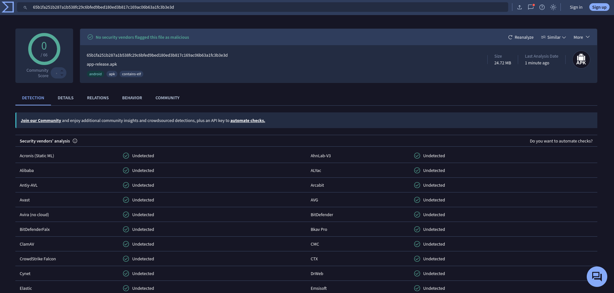

# MacroMaker

**Built out of spite for Macrorify <3**

MacroMaker automates taps, swipes and image-based actions on Android. You build macros
with a floating on-screen editor, right on top of the app you want to automate. No root
required. Free to use, no ads.

- Taps, swipes and gesture recording, with optional tap randomization
- Image and color recognition
- Conditions, functions, groups and variables
- Run statistics
- Import and export macros as ZIP files

Download the latest APK from [Releases](https://github.com/AstroStuff42/macromaker/releases).
Share macros, ask for help and give feedback on [Discord](https://discord.gg/XNvVKs6y5c).

## How to install

MacroMaker is installed from an APK file, not from Google Play, so Android shows a few
extra warnings. That is normal for apps from outside the Play Store.

1. Download `MacroMaker-1.0.apk` from the Releases page and open it.
2. If Android asks, allow your browser or file manager to **install unknown apps**.
3. If **Google Play Protect** warns about the app, tap **More details → Install anyway**.
   MacroMaker is new, so Google has not seen it before.
4. Open MacroMaker → **Permissions** → **Gesture access**, and try to turn MacroMaker on
   under **Accessibility**. On Android 13 and newer the switch may be greyed out
   ("Restricted setting"). If so:
   - Go to **Settings → Apps → MacroMaker**.
   - Tap **⋮** (top right) → **Allow restricted settings**, and confirm.
   - Go back to Accessibility and turn MacroMaker on.
5. Image recognition asks for screen-sharing permission each time a macro needs it.

Why Accessibility? MacroMaker uses it only to perform the taps and swipes you set up and
to show the floating controls. It does not read text from other apps, has no ads and
sends nothing anywhere.

Updating: install the new APK over the old one. Your macros stay. If Android says the
package conflicts, you have an unofficial build; export your macros, uninstall it, and
install the official APK.

## Verify the download (optional)

Version 1.0 `MacroMaker-1.0.apk`:

- **SHA-256:** `65b1fa251b287a1b538fc29c6bfed9bed180ed3b817c169ac06b63a1fc3b3e3d`
- **VirusTotal:** 0 / 66 vendors flagged it —
  [full report](https://www.virustotal.com/gui/file/65b1fa251b287a1b538fc29c6bfed9bed180ed3b817c169ac06b63a1fc3b3e3d)



Check the hash yourself:

```sh
sha256sum MacroMaker-1.0.apk                 # Linux
shasum -a 256 MacroMaker-1.0.apk             # macOS
Get-FileHash MacroMaker-1.0.apk              # Windows PowerShell
```

Every official release is signed with the same key. Its certificate SHA-256 fingerprint is
`F4:2B:CB:F2:3E:82:6C:6F:AF:8B:74:0B:7D:57:07:33:C7:99:1D:0B:46:7C:AD:47:4B:E2:83:F4:A5:98:A7:B0`
(check with `apksigner verify --print-certs MacroMaker-1.0.apk`). The file hash changes with
every version; the certificate never does.